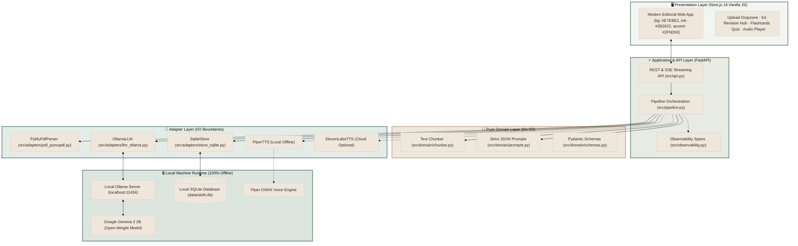
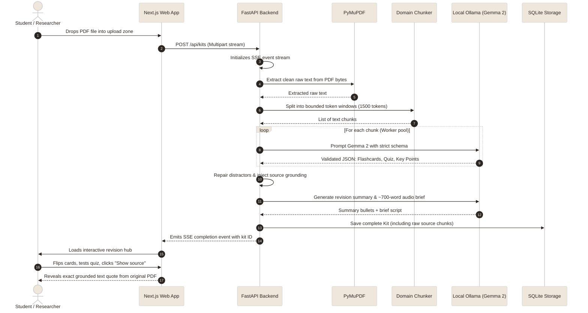

# Sloth Study 🦥

**Conserve your energy. Turn exhausting lecture decks and dense PDFs into verified flashcards, interactive quizzes with backing quotes, and spoken audio briefs—so you can learn more while doing less.**


-black?logo=next.js)


---

## 📌 Problem & The Sloth Solution

### The Study Fatigue & Cognitive Overload Gap
Studying for university exams, certifications, or professional licenses often hits a wall of friction:
1. **Passive Reading Paralysis**: Reading a dense 40-page PDF yields low retention without active recall and self-testing.
2. **Exhausting Manual Note-Making**: Crafting flashcards, distillation bullets, and quiz questions takes hours of tedious manual copying.
3. **Hallucination Anxiety**: Commercial AI chatbots frequently invent plausible-sounding facts, leading learners astray when studying high-stakes topics.
4. **Cloud Privacy Dilemmas**: Uploading internal proprietary research, proprietary course materials, or confidential notes to public cloud LLMs risks intellectual property leakage.
5. **Subscription & Token Fatigue**: Monthly fees or pay-per-token API costs restrict accessibility for students and self-learners worldwide.

### The Sloth Study Solution: Maximum Retention, Minimal Effort
**Sloth Study channels the spirit of International Sloth Day: slow, steady, and energy-conserving.** You drop in your PDF or lecture notes, and your computer does the heavy lifting locally:
- **Instant Revision Kits**: Automatically extracts key sections and writes grounded flashcards, multiple-choice quiz questions, bullet points, and an audio brief script.
- **Verbatim Grounding & Backing Quotes**: Every flashcard and quiz question retains a direct link to its source chunk. Click **"Show source"** to inspect the exact context from your notes.
- **Active Recall & Distractor Feedback**: The interactive quiz provides instant visual feedback (`.opt.right` / `.opt.wrong`) with grounded explanations.
- **100% Air-Gapped Data Sovereignty**: Operates completely offline with zero API calls, zero tracking, and zero subscription costs.

---

## 🏗️ Architecture & Data Flow

Sloth Study strictly isolates the **Domain** (zero I/O, pure business logic and schemas) from **Adapters** (external integrations for PDF extraction, local model inference, database storage, and speech synthesis).



---

### End-to-End Processing & Study Lifecycle



---

## 🛠️ Open-Weight & Open-Source Stack

| Component | Technology | Type | Why It Was Chosen |
|---|---|:---:|---|
| **Language Model** | [Google Gemma 2 2B](https://ollama.com/library/gemma2) | Open-Weight | High reasoning efficiency at only 1.6 GB. Runs fast on modest consumer CPUs with strict JSON schema compliance. |
| **Local Inference** | [Ollama](https://ollama.com/) | Open-Source | Production-grade, zero-config local engine for open-weight models on Windows, macOS, and Linux. |
| **PDF Extraction** | [PyMuPDF (fitz)](https://pymupdf.readthedocs.io/) | Open-Source | Blazing fast, pure-local document parsing with reliable text layout extraction. |
| **Frontend Framework** | [Next.js 16](https://nextjs.org/) | Open-Source | Fast modern web application using pure Vanilla CSS tokens matching the calm editorial aesthetic. |
| **Backend API** | [FastAPI](https://fastapi.tiangolo.com/) + Uvicorn | Open-Source | High-performance async Python server with native Server-Sent Events (SSE) streaming support. |
| **Local Database** | [SQLite](https://www.sqlite.org/) | Open-Source | Embedded zero-maintenance datastore storing complete kits and text chunk embeddings. |
| **Local Voice (TTS)** | [Piper TTS](https://github.com/rhasspy/piper) | Open-Source | Fast, lightweight local neural text-to-speech running on ONNX runtime. |
| **Observability** | [Sentry](https://sentry.io/) | Open-Source SDK | Distributed execution tracing with client-side zero-leakage guarantee (disabled by default). |

---

## 🌟 Key Features

### 1. Verifiable Flashcards with Grounding Toggle
- Auto-generates active-recall question/answer pairs from your notes.
- **Got It Tracking**: Mark cards as learned to track known count and progress.
- **"Show source" Inspection**: Every card contains a toggle revealing the exact raw chunk text from which the fact was extracted, eliminating hallucination worries.

### 2. Interactive Scored Quiz with Distractor Feedback
- Generates 4-option multiple-choice questions grounded strictly in your document.
- Visual feedback on selection: correct answers turn calming green (`.opt.right`), and incorrect options are highlighted (`.opt.wrong`).
- Displays immediate answer explanation and backing quote from the notes.

### 3. Spoken Audio Brief & Concise Bullets
- Synthesizes top-level takeaways into high-yield bullet points.
- Produces a conversational ~700-word audio brief script designed for listening while resting or taking a walk.
- Plays via local Piper TTS audio (or optional ElevenLabs voice synthesis).

### 4. Calm Editorial Aesthetics
- Designed with natural visual tones: background `#E7EBE2`, rich ink `#2B2622`, forest accent `#2F5D50`, and soft surface tints `#EFE7DB`.
- Modern serif headings, responsive mobile-friendly layouts, and subtle CSS micro-animations.

### 5. 100% Offline & Private
- No telemetry, no third-party cloud LLM tracking, and no hidden data transmissions.
- Operates entirely air-gapped on your laptop.

---

## 🚀 Quick Start Guide

### Prerequisites
- Python 3.11+
- Node.js 18+
- [Ollama](https://ollama.com/) installed and running

### 1. Pull the Local Model
```bash
ollama pull gemma2:2b
```
*(Optionally use `gemma3:4b` if your machine has additional storage).*

### 2. Configure Environment
Clone the repository and set up `.env`:
```bash
git clone https://github.com/Uxie7/sloth-study.git
cd sloth-study
cp .env.example .env
```
Default `.env` settings:
```env
LLM_BASE_URL=http://localhost:11434/v1
LLM_API_KEY=ollama
LLM_MODEL=gemma2:2b
TTS_PROVIDER=none
DATA_DIR=./data
MAX_CHUNK_TOKENS=1500
MAX_WORKERS=1
```

### 3. Start Python Backend
```bash
# Create and activate virtual environment
python -m venv .venv
# Windows:
.venv\Scripts\activate
# Mac/Linux:
source .venv/bin/activate

# Install dependencies
pip install -r requirements.txt

# Run FastAPI backend
uvicorn src.api:app --reload --port 8000
```

### 4. Start Next.js Frontend
In a new terminal window:
```bash
cd frontend
npm install
npm run dev
```

Open **`http://localhost:3000`** in your browser!

---

## 🧪 Running Tests & Quality Verification

```bash
# Run backend pytest suite (all 8 tests)
pytest tests/ -v

# Run frontend build check
cd frontend
npm run build
```

---

## 📂 Repository Structure

```text
sloth-study/
├── frontend/                        # Next.js 16 Web Application
│   ├── src/app/
│   │   ├── components/              # FlashCard.js, Quiz.js, AudioPlayer.js
│   │   ├── kit/[id]/page.js         # Revision kit view (Summary, Cards, Quiz, Audio)
│   │   ├── library/page.js          # Stored kits list
│   │   ├── upload/page.js           # Drag-and-drop PDF upload with SSE progress
│   │   ├── globals.css              # Calm editorial design system tokens
│   │   └── page.js                  # Landing hero & quick start
│   └── package.json
├── src/
│   ├── adapters/                    # I/O Adapters
│   │   ├── llm_ollama.py            # Ollama client with retry & repair
│   │   ├── pdf_pymupdf.py           # PyMuPDF document parser
│   │   ├── store_sqlite.py          # SQLite database storage
│   │   ├── tts_piper.py             # Piper local TTS adapter
│   │   └── tts_elevenlabs.py        # ElevenLabs cloud TTS adapter
│   ├── domain/                      # Pure Domain Logic (Zero I/O)
│   │   ├── chunker.py               # Token-aware sliding chunker
│   │   ├── prompts.py               # Strict Pydantic JSON prompt definitions
│   │   └── schemas.py               # Kit, Summary, Flashcard, Quiz schemas
│   ├── api.py                       # FastAPI endpoints & SSE progress streaming
│   ├── config.py                    # Environment settings
│   ├── observability.py             # Sentry span tracking
│   └── pipeline.py                  # End-to-end kit generation orchestrator
├── samples/                         # Test PDFs (finance, tech, history)
├── tests/                           # Pytest integration & smoke test suite
└── requirements.txt
```

---

## 📜 Credits and Licenses

| Component | Project / Model | Author | License |
| :--- | :--- | :--- | :--- |
| Project Code | Sloth Study | archangel2006 / Uxie7 | MIT |
| LLM Weights | Google Gemma 2 2B | Google DeepMind | Gemma Terms of Use |
| Local Inference | Ollama | Ollama Team | MIT |
| PDF Parsing | PyMuPDF | Artifex Software | AGPL-3.0 / Commercial |
| TTS Engine | Piper | Rhasspy / Michael Hansen | MIT |
| Web Framework | Next.js | Vercel | MIT |

Project source code is released under the [MIT License](LICENSE).
