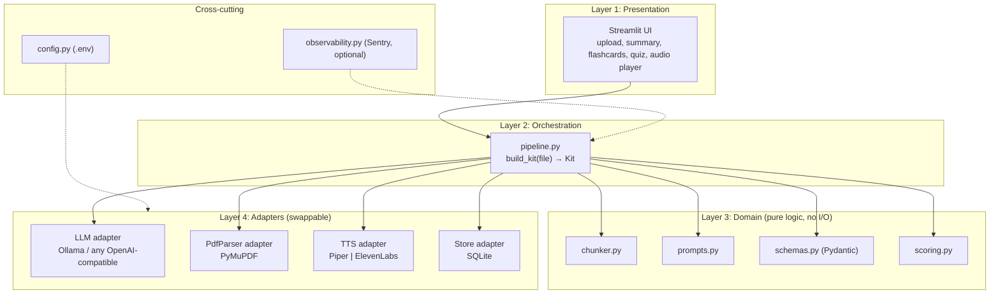
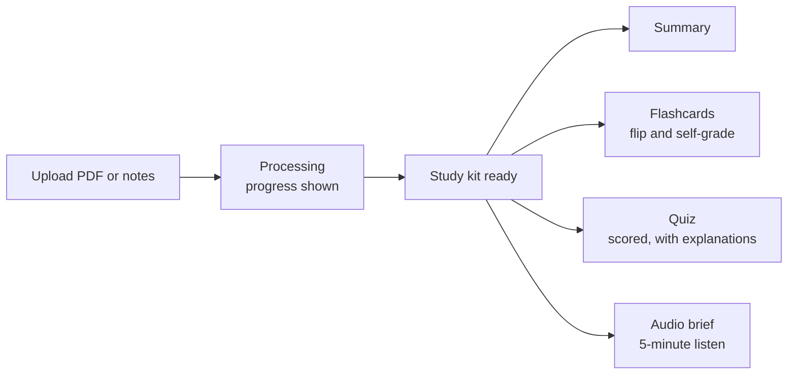
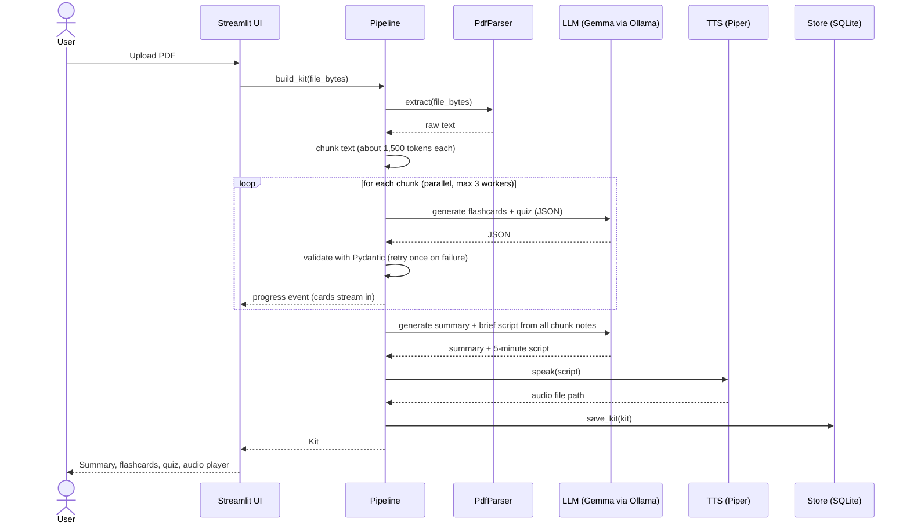
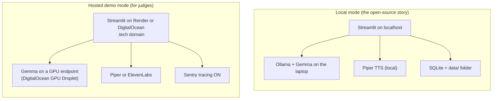
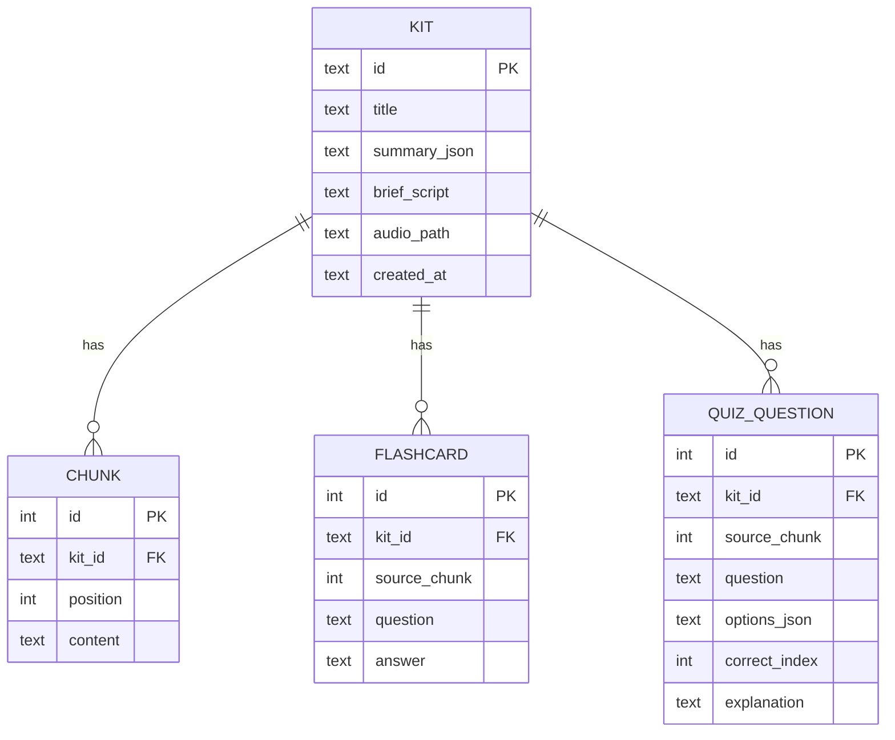

# Sloth Study: Project Context for the AI Builder

> Give this file to your AI builder (Claude Code, Cursor, Copilot, etc.) as the single source of truth. Build exactly what is described. Do not add features that are not listed under "MVP scope".

---

## 1. What we are building

**Sloth Study** turns lecture slides, PDFs, or notes into a revision kit: a summary, flashcards, a scored quiz, and a 5-minute audio revision brief. The user drops in a file and gets everything without making flashcards by hand.

**Pitch line:** "10 minutes instead of 3 hours of making flashcards. Runs on your laptop, no internet, no subscription."

### Challenge context (do not violate)

This is a submission for the **Hacktoberfest Open-Source AI Challenge, Week 3: Slow and Steady** (theme: build something that rewards laziness).

Hard requirements:

1. **Open-source AI must be the core.** An open-weight model (Gemma) running locally is what makes the project work.
2. **The core pipeline must work fully offline** (no internet, no cloud API required): PDF in, summary, flashcards, quiz, and audio brief out.
3. **User data stays on the user's machine.** Local SQLite and local files only.
4. **Models must be swappable** via configuration (change one env var, no code changes).
5. The write-up must explain why open innovation mattered (offline, private, zero cost, swappable models).

### Explicitly out of scope

- **No fine-tuning.** We are short on time. Quality comes from prompt design and output validation, not a tuned model.
- No user accounts or auth.
- No multi-file upload, no chat-with-notes, no vector database (post-MVP only).
- No mobile layout polish.

---

## 2. Prize tracks targeted

| Track | How we qualify | Notes |
|---|---|---|
| Gemma | Gemma runs the entire generation pipeline via Ollama | Core, always on |
| ElevenLabs | Optional "premium voice" toggle for the audio brief, and narration for the demo video | Cloud, off by default |
| Sentry Agent Tracing | Spans per pipeline step with latency, tokens, and cost | Off by default offline, on for hosted demo |
| Render or DigitalOcean | Host the UI (and optionally a GPU endpoint) for the public demo | Pick one |
| .tech domain | Live demo served on a claimed free .tech domain | Very low effort |

Do not add other sponsor integrations.

---

## 3. Language and framework decision

**Python 3.11+** with **Streamlit** for the UI. Reasons: fastest path for a time-boxed build, best ecosystem for PDF parsing, Ollama, and Piper TTS, and no JS build tooling.

> If the team prefers TypeScript, the architecture below is unchanged. Only the language and the UI framework differ (Next.js + Zod instead of Streamlit + Pydantic; Mastra can then be used for the workflow layer).

---

## 4. Tech stack

| Layer | Choice | Why |
|---|---|---|
| UI | Streamlit | One file per page, built-in file upload, audio player, session state |
| Orchestration | Plain Python pipeline (`pipeline.py`) | Simple, debuggable, no framework overhead |
| Model runtime | Ollama | One-command local inference, OpenAI-compatible endpoint |
| Model | Gemma (e.g. `gemma3:4b` for laptops, larger if GPU available) | Open-weight, runs locally |
| LLM client | `openai` Python SDK pointed at `LLM_BASE_URL` | Same code works for Ollama, vLLM, DigitalOcean GPU, or any compatible server |
| Validation | Pydantic v2 | Strict schemas, automatic retry on bad JSON |
| PDF parsing | PyMuPDF (`pymupdf`) | Fast, accurate text extraction |
| TTS (default) | Piper (`piper-tts`) | Local, offline, free |
| TTS (optional) | ElevenLabs SDK | Premium voice toggle, needs internet and API key |
| Storage | SQLite (`sqlite3`) + local `data/` folder | Local, zero setup, private |
| Observability | `sentry-sdk` | Optional, disabled unless `SENTRY_DSN` is set |
| Config | `python-dotenv` + `.env` | All switches in one place |
| Hosting (demo only) | Render or DigitalOcean | Public URL for judges |

---

## 5. Layered architecture

Rule: **each layer only calls the layer directly below it.** All external tools sit behind small interfaces in the adapter layer, so swapping a provider means changing one file or one env var.



### Layer responsibilities

| Layer | Owns | Must not |
|---|---|---|
| 1. Presentation | Rendering, user input, session state, streaming progress | Call Ollama, Piper, or SQLite directly |
| 2. Orchestration | Step order, retries, progress events, timing | Contain prompt text or schema definitions |
| 3. Domain | Chunking rules, prompt templates, Pydantic schemas, quiz scoring | Do any network, disk, or model calls |
| 4. Adapters | Talking to Ollama, PyMuPDF, Piper/ElevenLabs, SQLite | Contain business logic |
| Cross-cutting | Env config, optional tracing | Be required for the app to run |

---

## 6. User flow



Demo path (must work in under 30 seconds on a short PDF): drop PDF, watch cards appear, flip a card, take a 3-question quiz, press play on the audio brief.

---

## 7. Pipeline sequence



---

## 8. Deployment modes

The same code runs in both modes. Only `.env` changes.



Be honest in the write-up about which mode the live demo uses. Hosted mode exists only because judges will not install Ollama. Local mode is the real product.

---

## 9. Data model



### Pydantic schemas (`domain/schemas.py`)

```python
from pydantic import BaseModel, Field

class Flashcard(BaseModel):
    question: str = Field(min_length=5, max_length=200)
    answer: str = Field(min_length=1, max_length=200)  # one fact, short
    source_chunk: int

class QuizQuestion(BaseModel):
    question: str
    options: list[str] = Field(min_length=4, max_length=4)
    correct_index: int = Field(ge=0, le=3)
    explanation: str
    source_chunk: int

class ChunkOutput(BaseModel):
    flashcards: list[Flashcard]
    quiz: list[QuizQuestion]
    key_points: list[str]

class Summary(BaseModel):
    bullets: list[str]
    brief_script: str  # about 700 words, spoken style, about 5 minutes

class Kit(BaseModel):
    id: str
    title: str
    summary: Summary
    flashcards: list[Flashcard]
    quiz: list[QuizQuestion]
    audio_path: str | None = None
```

---

## 10. Adapter interfaces

Implement these as `typing.Protocol` classes. The pipeline depends only on these, never on concrete libraries.

```python
from typing import Protocol, TypeVar
from pathlib import Path
from pydantic import BaseModel

T = TypeVar("T", bound=BaseModel)

class LLM(Protocol):
    def generate_json(self, prompt: str, schema: type[T]) -> T: ...

class TTS(Protocol):
    def speak(self, text: str, out_path: Path) -> Path: ...

class PdfParser(Protocol):
    def extract(self, data: bytes) -> str: ...

class Store(Protocol):
    def save_kit(self, kit: "Kit") -> None: ...
    def get_kit(self, kit_id: str) -> "Kit": ...
    def list_kits(self) -> list[tuple[str, str]]: ...  # (id, title)
```

Concrete implementations:

| Interface | Default | Alternative |
|---|---|---|
| `LLM` | `OllamaLLM` (OpenAI SDK, `base_url=LLM_BASE_URL`) | Any OpenAI-compatible server |
| `TTS` | `PiperTTS` | `ElevenLabsTTS` (when `TTS_PROVIDER=elevenlabs`) |
| `PdfParser` | `PyMuPdfParser` | none |
| `Store` | `SqliteStore` | none |

---

## 11. Quality without fine-tuning

Since we are not fine-tuning, quality comes from these rules:

1. **Strict JSON output.** Ask for JSON only, pass the Pydantic schema as the format spec, and validate every response.
2. **One retry on failure.** If validation fails, re-prompt once with the validation error appended. If it fails again, skip that chunk and log it. Never crash the whole kit.
3. **One fact per flashcard.** Short question, short answer (under 25 words). Include 2 to 3 few-shot examples in the prompt.
4. **Quiz rules.** Four options, exactly one correct, plausible distractors drawn from the same chunk, a one-sentence explanation.
5. **Grounding.** Instruct the model to use only the provided chunk text and not invent facts.
6. **Chunk size cap.** About 1,500 tokens per chunk. Process chunks in parallel with a max of 3 workers (Ollama can be slow).
7. **Brief script style.** Spoken language, short sentences, no markdown, no bullet symbols, roughly 700 words.

Optional but valuable for the write-up: run 10 lecture chunks through a naive prompt and through the structured prompt, and report valid-JSON rate and card quality. This replaces the fine-tuning before/after chart.

---

## 12. Configuration (`.env`)

```env
# Model
LLM_BASE_URL=http://localhost:11434/v1
LLM_API_KEY=ollama
LLM_MODEL=gemma3:4b

# Voice
TTS_PROVIDER=piper            # piper | elevenlabs
PIPER_MODEL_PATH=./models/en_US-lessac-medium.onnx
ELEVENLABS_API_KEY=           # only needed if TTS_PROVIDER=elevenlabs

# Observability (leave empty to stay fully offline)
SENTRY_DSN=

# App
DATA_DIR=./data
MAX_CHUNK_TOKENS=1500
MAX_WORKERS=3
```

Rules:

- With only the defaults and Ollama + Piper installed, the app must work with the network disconnected.
- If `SENTRY_DSN` is empty, `observability.py` must be a no-op.
- If `TTS_PROVIDER=elevenlabs` but the key is missing or the network is down, fall back to Piper and show a notice.

---

## 13. Project structure

```
sloth-study/
├─ app.py                    # Streamlit entry (Layer 1)
├─ src/
│  ├─ pipeline.py            # build_kit() orchestration (Layer 2)
│  ├─ domain/                # Layer 3, pure logic
│  │  ├─ schemas.py
│  │  ├─ chunker.py
│  │  ├─ prompts.py
│  │  └─ scoring.py
│  ├─ adapters/              # Layer 4
│  │  ├─ interfaces.py       # Protocols
│  │  ├─ llm_ollama.py
│  │  ├─ pdf_pymupdf.py
│  │  ├─ tts_piper.py
│  │  ├─ tts_elevenlabs.py
│  │  └─ store_sqlite.py
│  ├─ config.py              # loads .env
│  └─ observability.py       # Sentry (optional)
├─ samples/                  # 2 to 3 open-license PDFs for one-click demo
├─ data/                     # SQLite db + generated audio (gitignored)
├─ models/                   # Piper voice model (gitignored)
├─ tests/
│  └─ test_pipeline_smoke.py
├─ .env.example
├─ requirements.txt
└─ README.md
```

---

## 14. MVP scope

| Must have | Nice to have | Cut |
|---|---|---|
| PDF upload | Cards streaming in as they finish | Fine-tuning |
| Summary, flashcards, scored quiz | Audio brief (Piper) | Auth and accounts |
| Pydantic validation with one retry | ElevenLabs toggle | Chat with notes, vector DB |
| SQLite save and reload kit | Sentry spans | Multi-file upload |
| Works offline end to end | Sample PDF buttons | Mobile polish |

### Cut order if time runs short

1. ElevenLabs toggle
2. Streaming (show a spinner instead)
3. Prompt comparison numbers
4. Sentry (but keep it if hitting that prize track)

Never cut: the core pipeline, offline operation, or the deployed demo.

---

## 15. Build order (time-boxed)

| Block | Time | Goal | Done when |
|---|---|---|---|
| 1 | 2 hrs | Core loop | Script: PDF in, Gemma returns validated JSON, printed to terminal |
| 2 | 2 hrs | UI | Streamlit shows summary, flip cards, scored quiz |
| 3 | 1 hr | Resilience | Retry on bad JSON, parallel chunks, progress bar |
| 4 | 1 hr | Audio | Piper brief plays in the UI, ElevenLabs toggle works |
| 5 | 45 min | Sentry | Spans per step, screenshot for the post |
| 6 | 1 hr | Deploy | Live on Render or DigitalOcean with .tech domain, sample PDFs wired |
| 7 | 1 hr | Write-up | DEV post using the challenge template, demo video |

---

## 16. Acceptance criteria

The build is done when all of these pass:

- [ ] With network disabled, uploading a 10-page PDF produces a summary, at least 10 flashcards, a 5-question quiz, and an audio brief.
- [ ] Every flashcard has one short question and a short answer; every quiz question has exactly 4 options and one correct answer.
- [ ] A malformed model response triggers one retry, then skips that chunk without crashing.
- [ ] Changing `LLM_MODEL` or `LLM_BASE_URL` in `.env` switches models with no code changes.
- [ ] Kits persist in SQLite and can be reopened after restarting the app.
- [ ] With `SENTRY_DSN` empty, no network calls are made for telemetry.
- [ ] Hosted demo loads at the public URL and a sample PDF produces a kit in under 60 seconds.
- [ ] README documents local setup: install Ollama, `ollama pull gemma3:4b`, download the Piper voice, `pip install -r requirements.txt`, `streamlit run app.py`.

---

## 17. Write-up outline (DEV post)

Follow the official template sections:

1. **What I Built:** Sloth Study, and the hours of flashcard-making it saves.
2. **Demo:** deployed link plus video.
3. **Code:** GitHub repo embed.
4. **How I Built It:** Gemma via Ollama, Piper, layered architecture with swappable adapters, Pydantic validation.
5. **Why Does Open Innovation Matter?** Works offline in exam season, notes never leave your machine, no subscription, models swappable with one env var. Include one honest comparison against a closed API (cost and privacy).
6. **My Agent Session:** optional, link the DevRelay session.
7. **The Lazy Payoff:** real numbers (minutes to build a kit vs. hours by hand).
8. **Prize Categories:** Gemma, ElevenLabs, Sentry Agent Tracing, Render or DigitalOcean, .tech domain.

---

## 18. Instructions to the AI builder

- Build in the block order from section 15. Finish and test each block before starting the next.
- Keep Layer 3 (domain) free of I/O so it is trivially testable.
- Never import Ollama, Piper, PyMuPDF, or SQLite outside `adapters/`.
- Do not add dependencies beyond the stack in section 4 without asking.
- Do not implement anything listed under "Out of scope" or "Cut".
- After each block, run the smoke test and report what works and what does not.
- Prefer simple, readable code over clever abstractions. This is a hackathon MVP.
